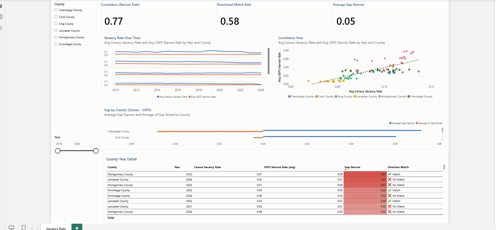
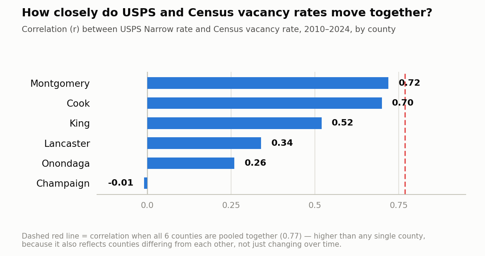
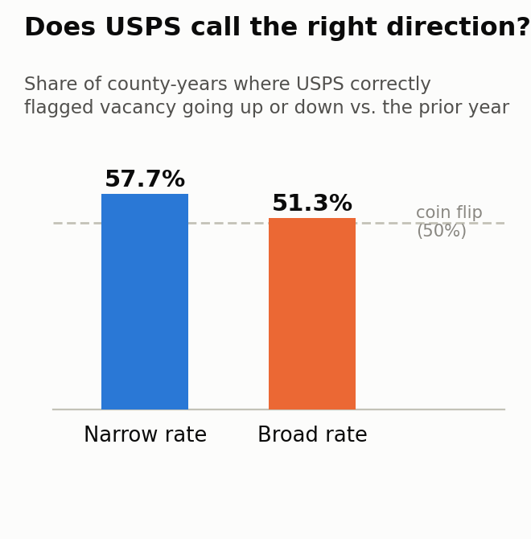
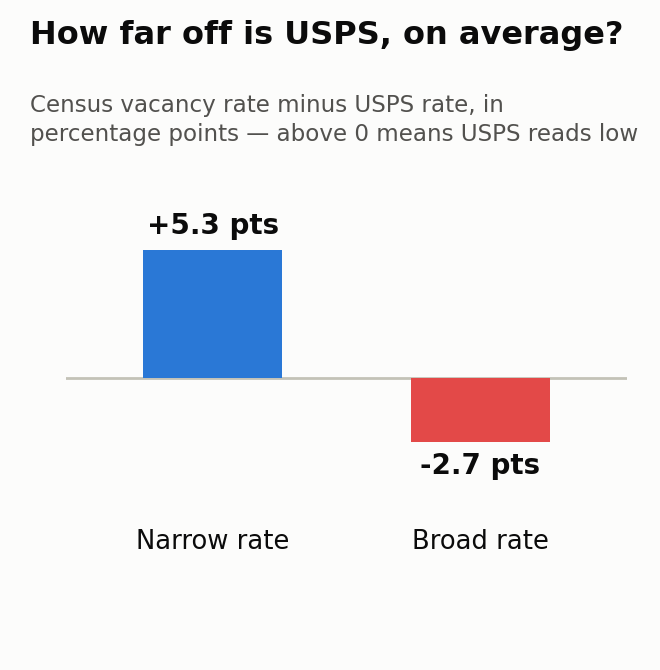
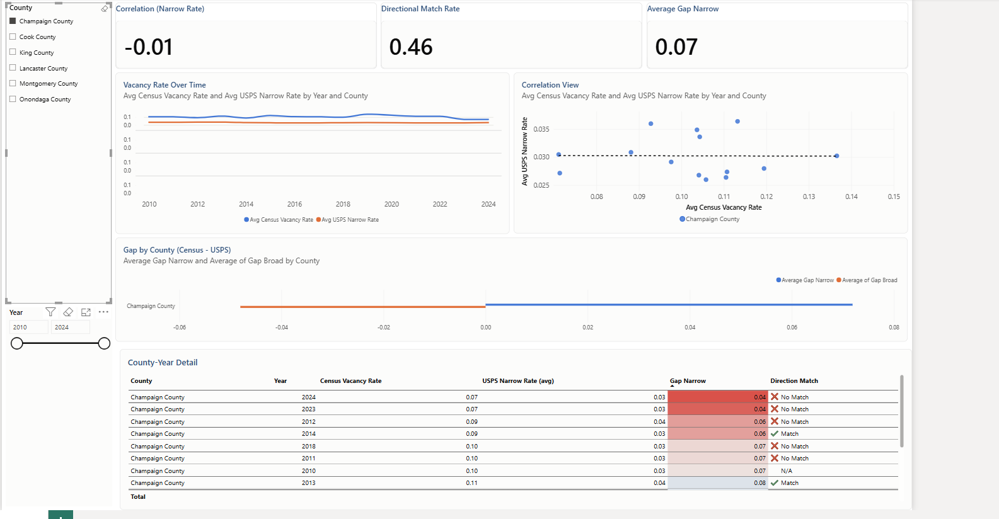
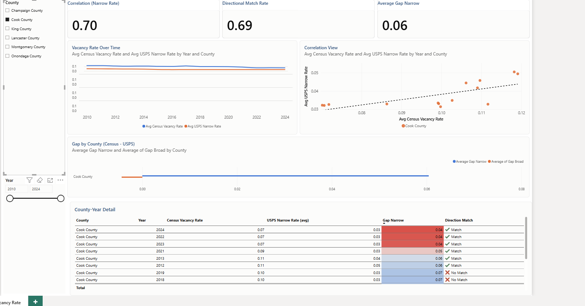
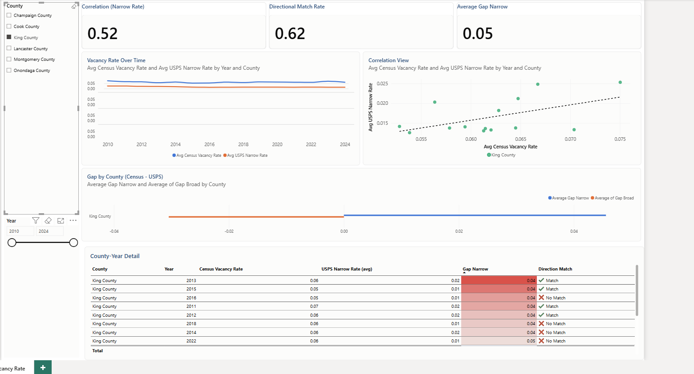
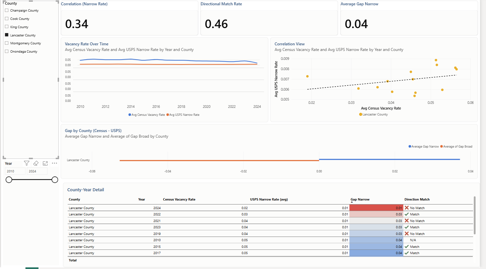
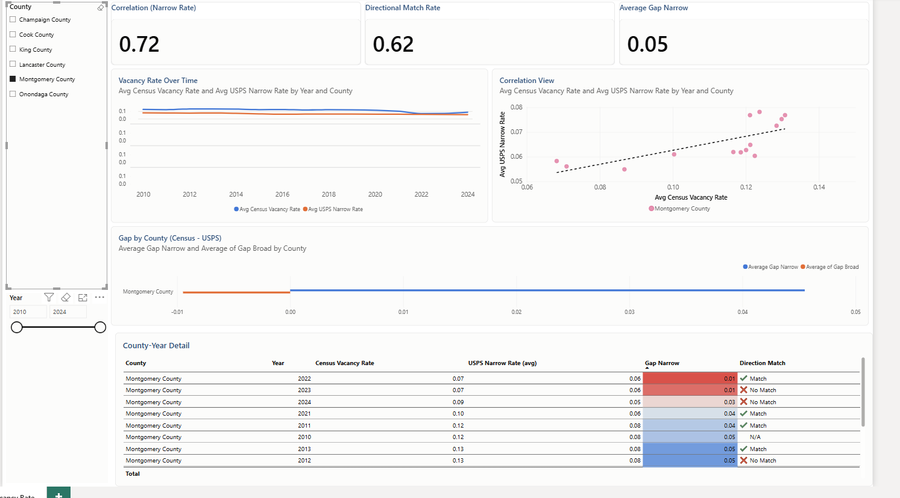
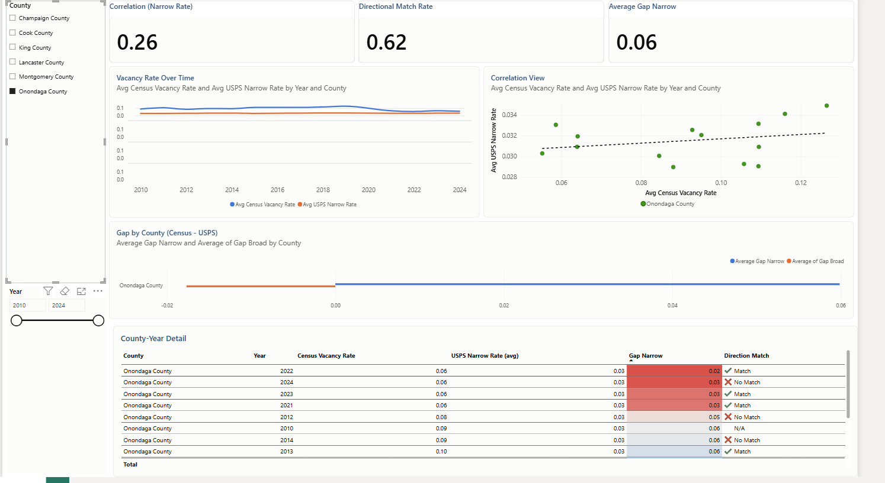

# USPS vs. Census Vacancy Rate — Can Mail Data Predict Housing Vacancy?


**In one sentence:** the U.S. Postal Service quietly publishes a vacancy count for every
ZIP code in the country, every quarter — this project asks whether that data is good
enough to stand in for the Census Bureau's official (but slow, annual) vacancy rate, and
answers it with a live Microsoft Fabric + Power BI pipeline instead of a guess.



## Why this matters (for the non-technical reader)

Knowing which neighborhoods have rising vacancy — empty homes, empty storefronts — is
core to how a local economic development office decides where to invest. The Census
Bureau's estimate is the gold standard, but it only comes out once a year and can lag
reality by a long time. The Postal Service, on the other hand, already tracks which
addresses aren't receiving mail — updated every quarter, for free, as a side effect of
mail delivery.

If USPS data reliably tracked the Census number, it would mean a much faster early-warning
signal for vacancy trends between official Census releases. This project tests that idea
against **six real U.S. counties and fifteen years of actual government data** (2010–2024,
84 county-year observations) and gives a real, three-part answer — not a hunch.

## What I found

**Do the two data sources move together?** Pooled across all six counties, yes,
fairly well (Pearson r = 0.77) — but that hides enormous variation by county, from
strong (Montgomery County, OH: r = 0.72) to no relationship at all (Champaign County,
IL: r = −0.01).



**Does USPS call the direction right?** Only somewhat — it correctly flags whether
vacancy is rising or falling 57.7% of the time, barely better than a coin flip.



**How far off is it, on average?** USPS's narrower estimate reads about 5.3 percentage
points *below* Census on average; its broader estimate reads about 2.7 points *above* —
and the two are biased in opposite directions, so there's no single correction factor
that would make either one line up with Census everywhere.



**Bottom line:** USPS vacancy data is a real, if county-dependent, early-warning signal —
useful to watch between Census releases, especially in counties where it tracks closely —
but it is not a substitute for the Census estimate itself. Full findings, per-county
breakdowns, and the reasoning behind each chart are in
[`docs/methodology.md`](docs/methodology.md).

## The dashboard

Every number above is live in a Power BI report connected directly to a Fabric semantic
model — checking or unchecking a county recalculates every KPI card and chart on the page
instantly, for that county alone. The screenshots below are the same report, filtered one
county at a time:

<table>
<tr>
<td></td>
<td></td>
<td></td>
</tr>
<tr>
<td align="center">Champaign — r = −0.01</td>
<td align="center">Cook — r = 0.70</td>
<td align="center">King — r = 0.52</td>
</tr>
<tr>
<td></td>
<td></td>
<td></td>
</tr>
<tr>
<td align="center">Lancaster — r = 0.34</td>
<td align="center">Montgomery — r = 0.72</td>
<td align="center">Onondaga — r = 0.26</td>
</tr>
</table>

The nine visuals on the page — two slicers, three KPI cards, a small-multiples line
chart, a scatter chart, a bar chart, and a detail table — are each documented with their
real field bindings in [`powerbi/report-definition`](powerbi/report-definition), extracted
directly from the report file rather than described from memory.

## Skills demonstrated

- **Microsoft Fabric** — Lakehouse ingestion, Dataflow Gen2, a semantic model live-connected
  to the report (not an imported/cached copy).
- **Power Query (M)** — combining and reshaping many quarterly CSVs with inconsistent
  headers into one clean table; see the header-casing bug in
  [`docs/methodology.md`](docs/methodology.md).
- **DAX** — calculated columns, gap-based year-over-year direction logic, and a
  hand-built Pearson correlation measure (`SUMX`-based; DAX has no native correlation
  function) — see [`powerbi/dax-measures.md`](powerbi/dax-measures.md).
- **Power BI report design** — a deliberate, hand-specified 1920×1080 layout grid, a
  custom validated color theme, and small multiples used specifically to work around a
  real Power BI limitation (a chart can legend by measure or by category, never both).
- **Statistical reasoning** — correlation vs. directional accuracy vs. systematic bias
  treated as three separate, complementary questions, plus catching and correctly
  attributing a real-world data artifact (the 2012 USPS classification shift) rather than
  reporting it as a finding.
- **Data validation** — every headline number in this README is independently
  reproducible from [`data/comparison_table.csv`](data/comparison_table.csv) with plain
  arithmetic (see [`docs/data-dictionary.md`](docs/data-dictionary.md)).

## Repository structure

```
.
├── README.md
├── docs/
│   ├── methodology.md        — data sources, pipeline, data-quality issues, how to reproduce the numbers
│   └── data-dictionary.md    — column-by-column description of comparison_table.csv
├── powerbi/
│   ├── dax-measures.md       — every DAX calculated column and measure, with commentary
│   ├── report-definition/    — the real Power BI report JSON (PBIR format), extracted from the .pbix
│   └── theme/                — the custom report color theme (source + the version actually loaded into Desktop)
├── data/
│   └── comparison_table.csv  — the full 84-row county-year dataset behind every chart
├── assets/                   — the three summary charts + a blank dashboard wireframe
└── screenshots/              — the live report, filtered one county at a time
```

## Suggested GitHub topics

`power-bi` `microsoft-fabric` `dax` `power-query` `data-analytics` `data-visualization`
`census-data` `usps` `government-data` `economic-development` `data-storytelling`

*(Add these under this repo's **Settings → General → Topics** — they aren't set from a
file, just typed into that field.)*

## License

Code and written analysis in this repository are released under the [MIT License](LICENSE).
The underlying Census and USPS data are U.S. government works and are in the public domain.
